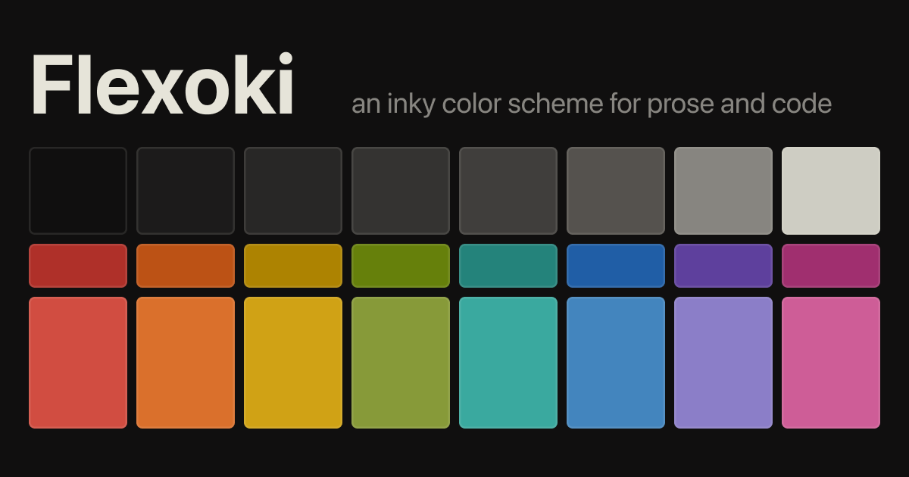
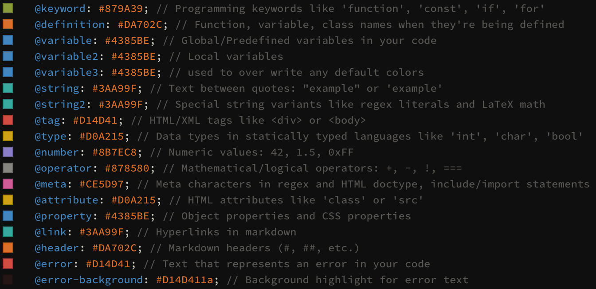
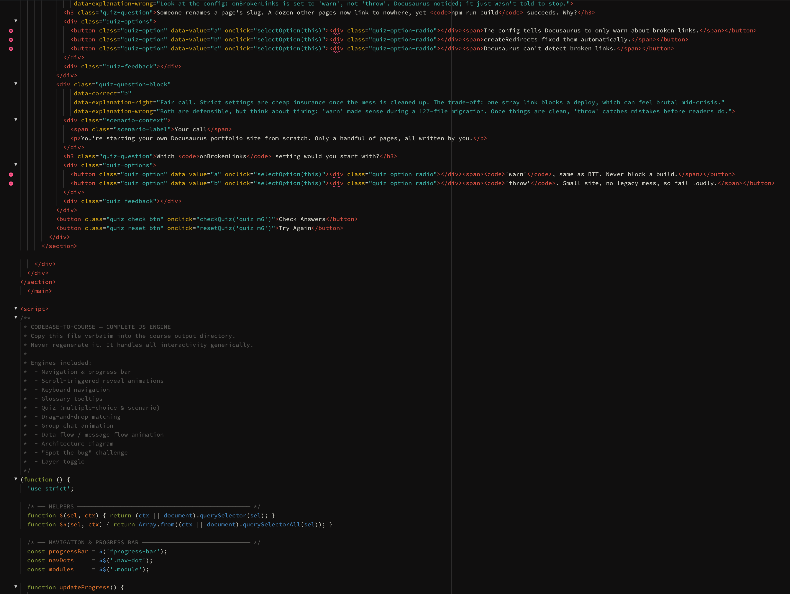

# Phoenix Code Theme - Flexoki Dark

A dark theme for [Phoenix Code](https://phcode.io), built on Flexoki.

Flexoki is an inky color scheme for prose and code. Flexoki is designed for reading and writing on digital screens. It is inspired by analog printing inks and warm shades of paper.

Learn more at [stephango.com/flexoki](https://stephango.com/flexoki)

## Install

1. In Phoenix Code, open **File > Extension Manager**
2. Go to the **Themes** tab and search for **Flexoki Dark**
3. Click **Install**, then choose the theme under **View > Themes**

## Colors

This theme uses the dark version of Flexoki: the `base` grays plus the `400` accent colors. For the full palette, see the [Flexoki documentation](https://stephango.com/flexoki).

### Interface

| Used for | Flexoki name | Hex |
| --- | --- | --- |
| Editor background | black | `#100F0F` |
| Panels, active line | base-950 | `#1C1B1A` |
| Borders, selected file | base-900 | `#282726` |
| Text selection | base-850 | `#343331` |
| Search matches | base-800 | `#403E3C` |
| Comments, line numbers | base-700 | `#575653` |
| Operators | base-500 | `#878580` |
| Text | base-200 | `#CECDC3` |
| Active file | orange-400 | `#DA702C` |

### Syntax

| Used for | Flexoki name | Hex |
| --- | --- | --- |
| Keywords | green-400 | `#879A39` |
| Function and class names, Markdown headers | orange-400 | `#DA702C` |
| Variables, properties | blue-400 | `#4385BE` |
| Strings, links | cyan-400 | `#3AA99F` |
| Numbers | purple-400 | `#8B7EC8` |
| Types, HTML attributes | yellow-400 | `#D0A215` |
| HTML tags, errors | red-400 | `#D14D41` |
| Doctype, imports, vendor prefixes | magenta-400 | `#CE5D97` |

## Example

## Credits

Colors from [Flexoki](https://stephango.com/flexoki) by Steph Ango, used under the MIT license.

Built from the [Phoenix Code theme template](https://github.com/phcode-dev/theme-template).

## License

MIT. See [LICENSE](LICENSE).